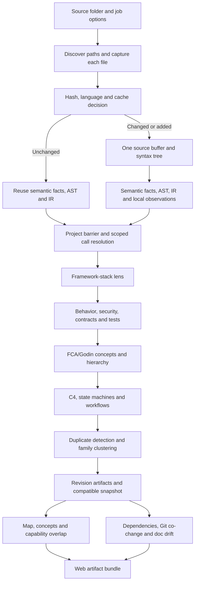
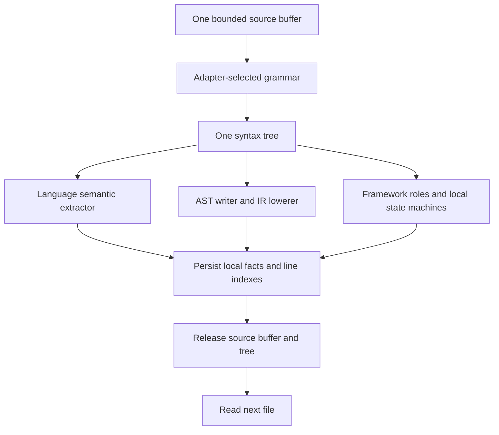

# Ingest-polyglot: implemented ingestion architecture

Updated: 2026-10-23.

## Entry point and ownership

```sh
cie ingest-polyglot /path/to/source --web-out /path/to/artifacts.json
```

`cie ingest` is a compatibility alias. `cie polyglot` delegates to the same
pipeline and retains its viewspec entry points, incremental receipts and `--full`
fresh-extraction escape hatch. The upstream per-file parse-row reuse APIs and
parity tests are retained for library callers. The web server still owns
cloning/local branch snapshots, the language preview, consent, job polling,
and result retention. After those steps it starts **one Rust process**.
`cie-cli/src/ingestion_job.rs` coordinates web exports; `cie-ingest/src/stream.rs`
owns file processing through the in-process [storage API](storage-module-architecture.md); existing analysis libraries retain their responsibilities.

## Ingestion dependency graph

This graph describes dependencies, not a claim that every branch executes
concurrently. The initial implementation intentionally processes one source
buffer/tree at a time. Project analysis stages currently run sequentially.



The framework-stack lens is a retained specialized reader. It has its own
bounded source collection/parsers and is **not yet converted to the shared-tree
interface**. Manifest, Docker/config, documentation and Git-history readers
also perform their domain-specific input reads. Thus “read once/parse once”
applies to the unified **file stream consumers**, not every reader in CIE.

The stream now calls `cie-storage` for cache lookup, file submission, graph
retrieval and publication. Storage is linked into the same process; SQL,
compression and artifact paths are no longer implemented by ingestion.

## Per-file chain and memory lifetime



Processors borrow the same Rust-owned source/tree. They do not exchange raw
memory addresses or communicate through child CLI processes. SQL and Shell
keep their existing text-based semantic extractors. Kotlin and Lua retain
their semantic adapters and now also have polyglot AST/IR grammar support.
TSX uses the TSX grammar, including in the deep TypeScript adapter.

* Source reading is bounded by 16 MiB + one overflow-detection byte per file.
* Binary, oversized and invalid UTF-8 inputs have explicit skip disclosures.
* Parse errors remain partial evidence, rather than an assertion of absence.
* Source/tree residency is bounded to one file in the core stream; compact
  facts, symbol indexes and cross-file graphs still grow with project size.
* The byte cap is not a hard RSS cap: syntax trees and extracted facts have
  their own allocation costs.
* Symlinks are not followed. Discovery uses the existing engine exclusion
  list, plus `.next`; this scanner does not implement full Git ignore syntax.

## Project barrier and identity

Local semantic facts keep adapter-local identifiers in the cache. At the
project barrier, files are sorted by path, symbol IDs and parent references
are remapped, and the existing scope/import-aware resolver connects files.
Polyglot call targets are then populated using source path and declaration
span identities. An unavailable mapping remains unresolved; the coordinator
does not choose the first unrelated symbol with a matching name.

Local folders are captured per file, not through an atomic filesystem snapshot.
Concurrent edits can therefore affect later file/domain-reader inputs; use a
Git branch snapshot when an immutable input is required.

The polyglot store's revision is stamped from the same revision allocator as
the compatible `.cie` snapshot, replacing the old hard-coded revision 41.

## Grouping and clustering

| Algorithm | Input and purpose | Owner and output |
|---|---|---|
| FCA/Godin concept lattice | Symbol attribute sets; overlapping capabilities and induction hierarchy | `cie-analysis/src/fca.rs` and `hierarchy.rs`; compatible snapshot concepts |
| Exact IR hash comparison | Find structurally equivalent normalized IR candidates under the existing detector's rules | `cie-polyglot/src/duplicates.rs`; canonical duplicate pairs |
| Cosine/shape similarity | Existing high/medium/low similarity tiers; retain Inference/Hypothesis encoding | Same duplicate detector; similarity pairs |
| Union-find with path compression and union by size | Connected components of canonical duplicate edges only | Rust ingestion; persisted `duplicate_clusters` table |
| Capability overlap/Jaccard comparison | Shared symbol membership across named concepts | `cie-concepts`; web overlap artifact |

Cosine similarity does not become proof of equivalence and does not enter
canonical duplicate families. Family hubs and member ordering are deterministic.
The web `getDuplicateClusters()` reader consumes the persisted table and no
longer reruns union-find. Older stores need re-ingestion to supply this table.

## Incremental updates and publication

1. A project-scoped OS file lock serializes writers and is released after a crash.
2. The prior SQLite store is consulted read-only. On the first required write,
   SQLite backup creates a consistent private build, including committed WAL frames.
3. Every source file is hashed from its captured buffer. Hash-matched semantic
   payloads reuse local facts and AST/IR; changed files use the shared-tree chain.
4. Deleted files remove their semantic, AST, symbol and IR rows. Project-wide
   derivations are invalidated; unchanged local observations remain reusable.
5. Unchanged ingestion retains the current revision when the snapshot and
   streaming store agree. Older/missing streaming stores force a migration pass.
6. Foreign-key integrity is checked. Derived polyglot stages and their statuses
   are recorded, and the store is checkpointed and promoted.
7. The compatible snapshot/index and revision head are published. Web exports
   are written to a temporary file and renamed when complete.

On changed revisions, SQLite backup currently copies the prior database,
including large derived results. Unchanged runs avoid this copy and avoid
building the global fact graph. Fact reuse does not make changed-build copies free. The
polyglot database and `.cie` snapshot are separate artifacts: their publication
is ordered, not one cross-store atomic transaction. A revision mismatch forces
rebuilding instead of serving it as an unchanged successful ingest.

## Web exports and progress

`--web-out` exports `report`, `viewspec`, `concepts`, `stack`, `polyglotSpecs`,
`deps`, `cochange`, `overlap`, `drift`, and optional captured `runtime` data.
Dependency usage reads stored semantic imports. Drift accepts the already
captured outcome rather than invoking ingestion again. Fault hypotheses use
the captured state model and retain their static-only semantics.

`CIE_STAGE` JSON lines on stderr carry stage progress to the Node job runner.
Existing status polling remains the browser-facing interface. Optional absent
outputs have explicit skipped states; the final bundle is required to contain
a valid core report. No application code is executed to obtain runtime data.

## Removed redundancy and compatibility

* Removed `polyglot_sources.rs`: the previous bridge merely decompressed source
  text and passed it through another extraction pass.
* Replaced byte-source bridge tests with shared-tree, semantic parity,
  incremental deletion/reuse, bounds and CLI/web integration tests.
* Removed the standalone CLI polyglot build/rename implementation.
* Removed the web process fan-out and TypeScript documentation-discovery helper;
  the Rust coordinator now owns those job stages.
* Removed web-side duplicate-family union-find; clustering is persisted at ingest.
* Removed the unused `web/src/lib/db.ts` Prisma template module, which had no
  importers and referenced an ungenerated client without a repository schema.

Existing standalone analysis commands remain for compatibility. They share the
new `run_ingest` implementation rather than a separate legacy parser. Specialized
framework-stack readers remain an explicit migration boundary, as noted above.

## Web progress contract

The web job launches one `ingest-polyglot --web-out` process. Its `CIE_STAGE` stderr events report actual phase boundaries: source streaming (including file/tree/cache counts), repository resolution, framework analysis, behavior/security/testing and FCA/Godin concept grouping, then storage publication with C4/state/workflow projections and duplicate clustering. Export events cover stored architecture views, the repository map, dependencies, co-change, overlap, documentation drift and final bundle publication. Cached revisions explicitly settle the reused phases.

The UI counts completed or skipped stages rather than estimating elapsed-time completion. A failure marks the active phase and preserves partial progress. Storage remains an in-process module.
