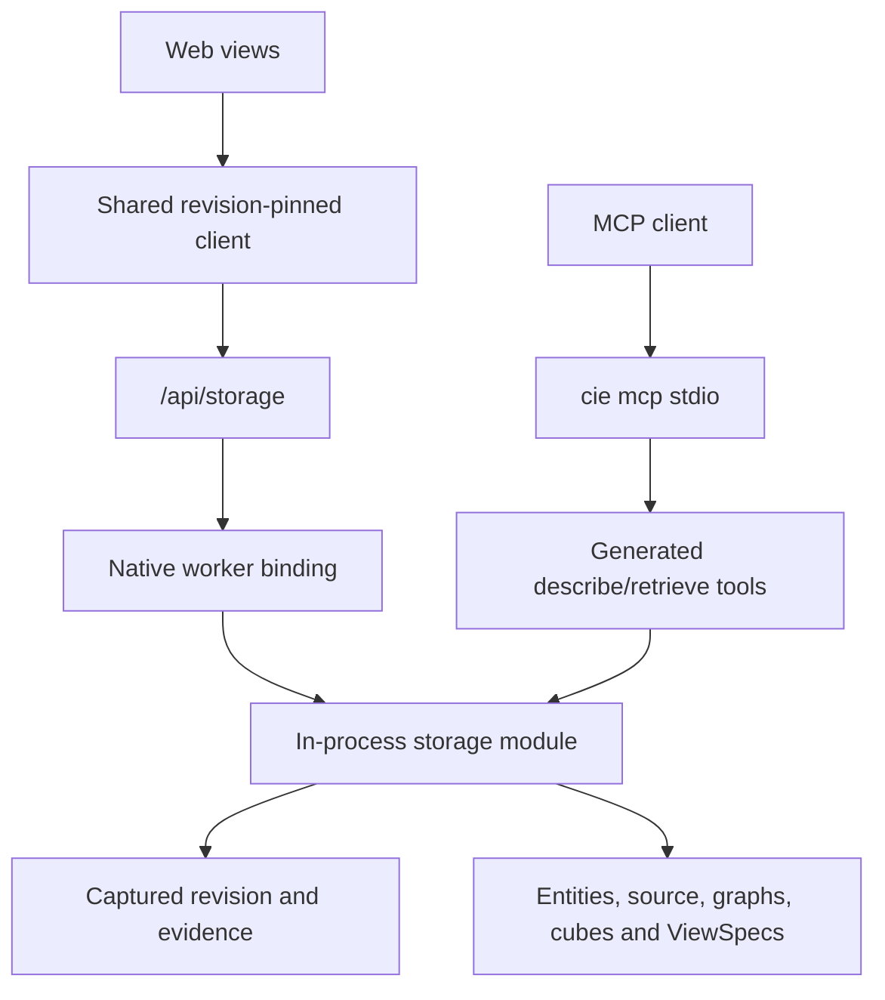

# UI and MCP storage consumers

The web app and MCP use the same in-process `cie-storage` retrieval contract. Storage owns persistence, revision selection, evidence identifiers, query planning, aggregation and output construction. Neither consumer reads SQLite directly or reads current source files as a fallback.



## Web

`storage-client.ts` owns pinned context lifecycle, opaque pagination cursors and schema-v2 validation. `storage-ui.ts` maps typed storage outputs to presentation models for symbols, source, function IR, impact, duplicate pairs and duplicate clusters. A repository or revision change closes the previous context. Cluster members are expanded in a bounded batch and truncation is disclosed. Inventory and row inspection use the storage-owned redacted diagnostics API.

Analysis jobs persist only the storage root, revision and presentation metadata. `/api/analyze/result` retrieves `ui_bootstrap_v1` from that exact revision; older saved jobs are migrated to references when possible. Missing storage is an error, never a stale report fallback.

## MCP

Configure a host-selected repository that has already been ingested:

```json
{"mcpServers":{"cie":{"command":"/absolute/path/cie","args":["mcp","/absolute/path/repository","--revision","1","--budget-ms","10000"]}}}
```

Omit `--revision` to select the latest revision when a new context is explicitly opened. `cie_describe` opens a context or reuses one supplied in its arguments. Pass its context to `cie_retrieve`. Input schemas are generated from the storage tool DTOs; retrieval requires a context. Both tools return JSON text and structured content. Source evidence is untrusted data.

The stdio host supports initialization, discovery, ping and cancellation, bounded messages, request queues and execution budgets. It exposes no ingestion, arbitrary repository selection, SQL or code execution tool. Contexts expire after fifteen idle minutes and are bounded per process; restart the session to release all contexts.

## Removed implementations

Removed the SQL compatibility retrieval module, native compatibility dispatch, legacy `polyglot-db` and repository-fetch helpers, MCP scaffold/executor interfaces, and `/api/polyglot/*`, `/api/impact`, `/api/fs/file` routes. Administration components are now named for storage. Unused server dependencies were removed.

The `cie-polyglot` and `cie-store` crates remain active ingestion and physical storage dependencies. Removing them would break the current backend; their obsolete consumer interfaces, rather than these working packages, were removed.

## Verification

Coverage includes real native browser selectors, pinned pagination and context closure, schema validation, reference-only job results, stdio MCP retrieval across revisions, captured source after source deletion, cancellation, invalid requests and legacy-tool refusal. The standalone smoke test retrieves captured source through `/api/storage` after deleting the original source file.
