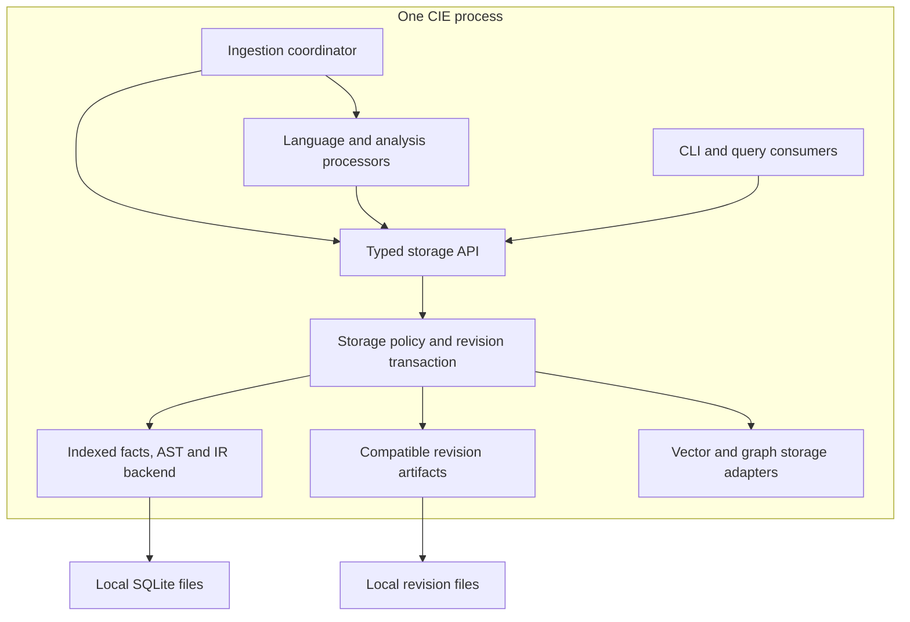

# Storage module: in-process responsibility boundary

Updated: 2026-10-23.

## Deployment

Storage is a Rust library module, linked into the **same CIE process**.
The `cie-storage` workspace package has no executable, server, HTTP endpoint,
queue consumer, or network deployment. Its public methods are ordinary Rust
calls. Files and syntax trees remain borrowed in memory across the API boundary.



The existing web server remains the UI host. It launches one ingestion process,
as it did before this storage extension; storage introduces no extra process.

## Ownership

| Concern | Owner |
|---|---|
| Discover source files, select a language, parse and extract facts | Ingestion and language processors |
| Define the meaning of symbols, calls, findings and concepts | Domain model/analysis modules |
| Select physical records, schemas, indexes and serialization | Storage module and backend adapters |
| Select source-cache compression level and database cache size | Storage policy |
| Writer lease, private build, rollback and database promotion | Storage revision transaction |
| Select a file processing order and project-analysis dependencies | Ingestion coordinator |
| Store and load stack/state/relations/embedding/org artifacts | Storage module |
| Bound query result pages and execute indexed predicates | Storage reader |
| Render charts and interpret UI selection | Web UI |

Domain structures such as `LangFacts` describe code semantics. They remain the
input contract. They do not prescribe SQL tables, B-tree layouts, JSON paths,
compression, file naming, or transaction strategy.

## Public API

The first production client is the ingestion stream. Its hot path has no SQL,
SQLite connections, DDL, compression, or physical cache layout code.

```rust
let mut storage = RepositoryWriter::open(project, StoragePolicy::default())?;

if storage.lookup_file(relative_path, &content_hash)?.is_none() {
    storage.put_file(FileSubmission {
        path: relative_path,
        hash: content_hash,
        source: &source,
        facts,
        tree: tree.as_ref(),
    })?;
}

storage.reconcile_files(&seen_paths)?;
let graph = storage.materialize()?;
// Analysis uses graph, then submits the revision for publication.
let publication = storage.commit(revision, &graph, &receipt, &skipped_inputs)?;
// Keep the publication lease until compatible snapshot/head publication ends.
```

`put_file` validates the normalized relative identity, source hash and fact path.
The transaction owns its repository root: callers cannot redirect a commit into
another repository by supplying a second root.

Read APIs include:

```rust
let reader = RepositoryReader::open(project, StoragePolicy::default())?;
let facts = reader.file_facts("src/service.py")?;
let symbols = reader.symbols(&SymbolQuery {
    name: Some("authorize".into()),
    limit: 50,
    ..Default::default()
})?;
```

Symbol predicates use bound parameters; filters and pagination are selected
inside storage. Results carry revision identity. The initial symbol query reads
the AST-backed symbol projection; `file_facts` covers the complete semantic
adapter payload, including text-based languages. These are distinct contracts.

`RevisionArtifacts::put/get` accepts a revision and an `Artifact` kind. Callers
no longer construct filenames for file tables, unresolved calls, or polyglot web
exports. Older typed extension methods remain compatible public APIs.

## Storage policies

There is no universal “best” data structure. This implementation uses explicit
workload policies; it does not claim to infer an optimal backend or dynamically
migrate databases without measurements.

| Profile | SQLite page cache target | Source zstd level | Large temporary operations |
|---|---:|---:|---|
| LowMemory | 8 MiB | 1 | Spill to disk |
| Interactive, default | 32 MiB | 3 | Memory temporary store |
| Bulk | 64 MiB | 1 | Memory temporary store |

All profiles enforce a maximum query page size (default 500), parameterized
predicates and a five-second database busy timeout. SQLite WAL, schema/index
creation, source compression and private-build publication remain backend
implementation details. The page cache target is not a total-process RSS limit.

The first backend combination preserves compatibility:

* Indexed SQLite rows for file identities, AST/IR, semantic payloads and derived
  projections; existing content-hashed text interning remains available.
* Compressed source-cache blobs for later source retrieval.
* Atomic compatible JSON revision artifacts where existing consumers require them.
* Existing graph and HNSW adapters for their corresponding query workloads.

Changing these physical choices is a storage-module change. Ingestion keeps its
typed calls. Current performance mechanisms include lazy copy-on-write staging,
no-op metadata checks, reuse of hash-matched facts, bounded pages, and deterministic
indexed equality filters. Changed builds still copy the prior SQLite database.

## Transactions and failure behavior

Opening a writer acquires the repository lease inside storage. Unchanged runs
consult metadata read-only. The first mutation creates a private consistent
SQLite build; file deletion and dependent-index invalidation happen there.
Dropping an uncommitted writer rolls back and deletes scratch data. Existing
readers continue to see the previous promoted database.

Commit checks referential integrity, stamps revision identity, refreshes registered
polyglot materialized projections, writes revision artifacts, and promotes the
checkpointed database. It returns a publication lease so the coordinator can
finish compatibility snapshot/head publication without another writer interleaving.
The database and legacy JSON head still are not one cross-backend atomic transaction;
revision mismatch detection remains the recovery boundary.

Polyglot projection algorithms remain in their existing analysis modules. The
storage backend invokes these adapters over its private build; storage does not
invent new domain findings or select a different clustering algorithm. Separating
pure projection computation from SQL-writing backend adapters is a later internal
refinement, not something this migration claims to have completed.

## Migration and remaining boundaries

Moved from ingestion to storage:

* SQLite connections, staging/backup/promotion, SQL schema use and fact serialization.
* Stack, state-model, relation-graph, vector and organization persistence modules.
* Source-cache encoding, cache lookups, source identity validation and file removal.
* Revision-artifact path selection for file tables/unresolved calls/web projections.

The old ingestion module paths re-export the relocated implementations to preserve
source compatibility. The duplicated files have been removed, rather than copied.

The legacy `cie-store` and domain extension traits are retained as backend/compatibility
components. Existing web table-browser/duplicate readers still access their SQLite
read adapter directly; migrating every web query to the Rust reader API is a separate
consumer migration. No new storage process is required for that migration.

Tests cover shared ingestion behavior, bounded typed reads, invalid identities,
rollback visibility, old-reader continuity, revision identity, and policy validation.

## Proposed retrieval extension

See the [storage retrieval and ViewSpec API specification](storage-retrieval-api-spec.md) for the proposed revision-pinned query and multi-output contract. This extension is specified, not yet implemented.
